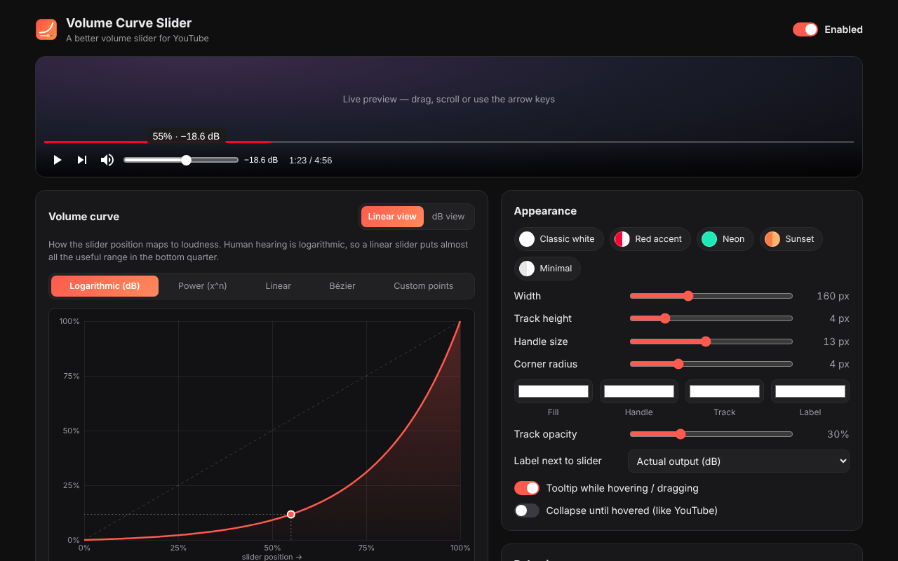

# Volume Curve Slider for YouTube

A Chrome extension (Manifest V3) that replaces YouTube's volume slider with a customizable one.



## Features

**Volume curves.** YouTube's slider is linear, but hearing is logarithmic, so most of the useful range sits in the bottom quarter of the slider. You can pick:

| Curve                            | What it does                                                                                                                                                                                                               |
| -------------------------------- | -------------------------------------------------------------------------------------------------------------------------------------------------------------------------------------------------------------------------- |
| **Logarithmic (dB)** _(default)_ | Each step is the same number of decibels. You set the dynamic range (10–90 dB, default 40). The curve is still exactly 0 at the bottom and 100% at the top.                                                                |
| **Power**                        | output = positionⁿ, with n adjustable (0.2–8).                                                                                                                                                                             |
| **Linear**                       | Same as YouTube's slider.                                                                                                                                                                                                  |
| **Bézier**                       | A CSS‑style `cubic-bezier()`. Drag the two handles on the graph.                                                                                                                                                           |
| **Custom points**                | Click the graph to add points, drag them, and double‑click to remove. The points are joined with monotone cubic interpolation, so the curve never overshoots them. Editing in the dB view gives fine control near silence. |

You can also set a **maximum output** cap, and turn any curve into editable custom points with one click.

**Appearance.** You can change the width (30–400 px), track height, handle size (or hide the handle), corner radius, and the fill, handle, track and label colors, plus track opacity. There are also:

- an optional label next to the slider showing position %, actual output % or dB
- a hover tooltip
- a "collapse until hovered" mode that works like YouTube's slider
- five presets

**Smooth audio**

- The volume is applied with full floating‑point precision, not YouTube's 1% integer steps. This matters at the quiet end of a logarithmic curve.
- Changes ramp over a short, configurable time (default 60 ms), so dragging never clicks or crackles.
- YouTube's loudness normalization still works.
- New `<video>` elements are patched synchronously, from a MutationObserver microtask, before they can make a sound. Ads and video changes don't cause volume jumps.

**Controls.** You can drag or click the slider, use the mouse wheel over it (with smooth trackpad support), and use the arrow keys, Home and End when it has focus. ↑/↓ in the player move _this_ slider and show an on‑screen volume readout. The mute button and the M key keep working, and moving the slider unmutes.

**Other.** It works on youtube.com and in embedded players (youtube.com/embed, youtube‑nocookie.com). Settings sync across your Chrome profile and apply live to open tabs. You can export and import settings as JSON.

## How it works

```
 bridge.js (isolated world)            main.js (page world)
 ───────────────────────────           ───────────────────────────────────────
 chrome.storage.sync  (settings) ──►  CustomEvent 'yvs:state' ──► curve + UI
 chrome.storage.local (position) ◄──  CustomEvent 'yvs:save-position'
```

YouTube keeps its own 0–100 volume and writes `video.volume = volume/100 × normalization`. The extension does three things:

1. It pins YouTube's own volume at **100**, through the player API (`setVolume`).
2. It overrides the `volume` property on each `<video>` **instance**. When YouTube writes a value, the extension remembers it and plays `value × curve(position)`. When YouTube reads the value back, it gets exactly what it wrote. Because YouTube always sees its own value, it never "corrects" the volume, and there's no feedback loop or jitter.
3. It hides `.ytp-volume-panel` and puts the custom slider in its place in `.ytp-volume-area`.

The DOM is built without `innerHTML`, because YouTube enforces Trusted Types. Turning the extension off removes the override and gives YouTube its slider back at the same loudness.

## Project layout

```
manifest.json
src/shared/     curves.js (math) · settings.js (schema/defaults) · format.js (display text)
                slider.js + slider.css (widget)
src/content/    bridge.js (isolated world) · gain.js (per-video gain) + main.js (page world)
src/options/    full settings page with the interactive curve editor
src/popup/      quick toggle / curve / width
icons/          extension icons (generated by scripts/make-icons.py)
store/          Chrome Web Store promo tiles and screenshots
test/           unit tests (node:test) and end-to-end tests (real Chrome)
scripts/        build (zip), screenshots, icons
```

## Development

Requirements: Node 18+ and Google Chrome.

```bash
npm install          # dev tools: Prettier, ESLint, playwright-core (e2e)
npm run check        # lint + format check + unit tests
npm run format       # apply Prettier formatting
npm test             # unit tests: curve math and settings validation
npm run test:e2e     # real Chrome: a mock YouTube player plus the unpacked extension
npm run build        # -> dist/youtube-volume-slider-<version>.zip
```

Source style follows the PermaFormula web conventions: four-space indentation, a
100-column target (two spaces for YAML), single quotes and trailing commas, applied
by Prettier (`.prettierrc.json`). ESLint (`eslint.config.mjs`) enforces braces on
every conditional and loop body, `===`, `const`/`let`, template literals instead of
string concatenation, and explicit (non-implicit) type coercion. Unused catch
bindings are omitted (`catch {`). Preferring collection operations over loops
without extra mutable state remains a review requirement. CI runs lint and the
format check.

If Chrome isn't found automatically, set `CHROME_PATH`. On Windows, for example: `set CHROME_PATH=C:\Program Files\Google\Chrome\Application\chrome.exe`.

**Load it unpacked:** open `chrome://extensions`, turn on **Developer mode**, click **Load unpacked** and select this folder. After you edit the code, click the extension's reload button and refresh the YouTube tab.

## Publishing to the Chrome Web Store

1. Bump `version` in **both** `manifest.json` and `package.json`. The build fails if they differ.
2. Run `npm run check && npm run test:e2e && npm run build`.
3. Go to the [Chrome Web Store Developer Dashboard](https://chrome.google.com/webstore/devconsole). There's a one‑time US$5 registration fee. Click **New item** and upload `dist/youtube-volume-slider-<version>.zip`.
4. Fill in the listing from [`STORE_LISTING.md`](STORE_LISTING.md). It has ready‑to‑paste text, the single‑purpose statement, permission justifications and data‑use answers. Upload the images from `store/`.
5. Host [`PRIVACY.md`](PRIVACY.md) somewhere public, such as GitHub or GitHub Pages, and paste its URL into the privacy policy field.
6. Submit for review.

There's also a GitHub Actions workflow (`.github/workflows/ci.yml`). It runs all tests and builds the zip on every push. When you push a `v*` tag, it attaches the zip to a GitHub release.

## License

MIT. This project is not affiliated with YouTube or Google.
